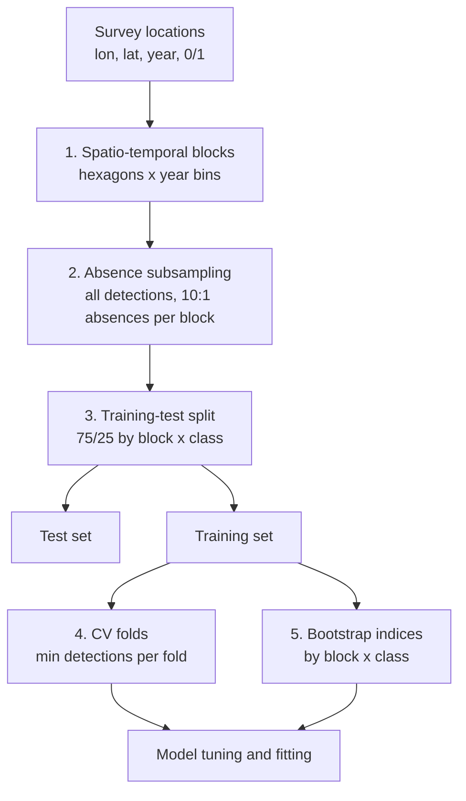

# Spatio-temporal stratification of survey locations

## Overview

Species survey data are rarely spread evenly in space or time. Effort concentrates near roads, in particular regions, and in recent years, and detections of a given species often come from a small part of the study area. Unstratified resampling of such data can produce training, validation, and bootstrap sets that over-represent well-surveyed places and periods. This method assigns every survey location to a spatio-temporal block (an equal-area hexagonal cell crossed with a quantile-based year bin) and uses those blocks as the stratification unit at each resampling stage of a presence–absence modelling workflow.

The blocks serve two purposes. First, they control where absences are kept: every detection is retained, absences are subsampled to a fixed ratio within each block, and blocks with no detections are discarded. This thins absences at the block level and leaves the detections intact. Second, they stratify the training–test split, the cross-validation (CV) folds, and the bootstrap resamples, so that each set draws from the same blocks in the same class proportions. The folds are block-stratified rather than block-independent, which matters for how CV error should be read (see Drawbacks and limitations).

| Inputs | Outputs | Languages and platforms | Run time |
|---|---|---|---|
| Survey locations with longitude, latitude, year, and a 0/1 response | Block labels per location, a thinned modelling dataset, a training–test split, CV fold IDs, and a bootstrap index matrix | R | A few seconds for the 10,000-location example |

## Workflow at a glance

1. Build spatial blocks from a global hexagonal grid (150-km spacing) and temporal blocks from five quantile-based year bins, then combine them into spatio-temporal blocks.
2. Keep all detections and subsample absences at 10 per detection (minimum 2) within each block, dropping blocks with no detections.
3. Split the data 75/25 into training and test sets within each block × class group.
4. Choose the largest number of folds that gives every fold a minimum number of detections, then assign folds within each block × class group.
5. Draw bootstrap resamples with replacement within each block × class group.



## Requirements

- R with `dplyr`, `purrr`, `dggridR`, `sf`, and `ggplot2`, plus `rnaturalearth` and `rnaturalearthhires` for the Alberta boundary, and `utilR` (github.com/bgcasey/utilR) for `theme_science_map()`. The example was run with R 4.5.0, `dggridR` 3.1.0, `dplyr` 1.1.4, `purrr` 1.0.4, `sf` 1.1.2, and `ggplot2` 4.0.3.
- Four helper functions in `R/`: `sample_blocks_binomial()`, `stratified_split()`, `choose_folds_min_detections()` with `assign_spatial_cv_folds()`, and `assign_bootstrap_ids_m()`.
- Survey data with one row per location–visit and columns for longitude and latitude (WGS84), year, and a 0/1 response. The example simulates these.

The code chunks below run in order from this vignette's folder (`vignettes/spatio_temporal_blocking/`). The complete script is in `example.R`.

### Simulated survey data

We simulate 10,000 survey locations distributed randomly within the Alberta boundary between 2000 and 2024. Detection probability increases toward the south-east so that some blocks have many detections and others have none.

```r
library(dplyr)
library(purrr)
library(ggplot2)
library(sf)
library(dggridR)
library(rnaturalearth)
library(MetBrewer)
library(utilR) # theme_science_map()

source("R/sample_blocks_binomial.R")
source("R/stratified_split.R")
source("R/assign_spatial_cv_folds.R")
source("R/assign_bootstrap_ids_matrix.R")

alberta <- ne_states(country = "Canada", returnclass = "sf") %>%
  filter(name_en == "Alberta")

set.seed(42)
n <- 10000
locations <- st_sample(alberta, size = n) %>%
  st_coordinates()

data <- tibble(
  longitude = locations[, "X"],
  latitude  = locations[, "Y"],
  year      = sample(2000:2024, n, replace = TRUE)
) %>%
  mutate(
    p_det    = plogis(-3.5 + 0.35 * (60 - latitude) / 2 +
                        0.2 * (longitude + 120) / 2),
    presence = rbinom(n, 1, p_det)
  ) %>%
  select(-p_det)
```

## Step-by-step

### Step 1: Build spatial and temporal blocks

Spatial blocks come from a global discrete grid of hexagons rather than a projected rectangular grid, so cells have approximately equal area across large extents. `dgconstruct()` picks the grid resolution whose cell-centre spacing is closest to the requested 150 km, and `dgGEO_to_SEQNUM()` returns the ID of the cell that contains each location. Temporal blocks bin survey years at the 20th, 40th, 60th, and 80th percentiles, so each bin holds roughly one fifth of the observations rather than one fifth of the years. The spatio-temporal block is the observed combination of the two, renumbered `block_1`, `block_2`, and so on.

```r
grid <- dgconstruct(
  spacing = 150,
  metric = TRUE
)

data <- data %>%
  mutate(
    # Assign points to spatial blocks using the precomputed grid
    spatial_block = dgGEO_to_SEQNUM(
      grid,
      longitude,
      latitude
    )$seqnum,
    # Create quantile-based temporal blocks
    temporal_block = cut(
      year,
      breaks = quantile(
        year,
        probs = seq(0, 1, by = 0.2),
        na.rm = TRUE
      ),
      include.lowest = TRUE,
      right = FALSE
    ),
    # Combine spatial and temporal blocks
    spatio_temporal_block = interaction(
      droplevels(as.factor(spatial_block)),
      droplevels(as.factor(temporal_block)),
      sep = "::",
      drop = TRUE
    )
  ) %>%
  group_by(spatio_temporal_block) %>%
  mutate(
    spatio_temporal_block = paste0(
      "block_", cur_group_id()
    )
  ) %>%
  ungroup()

data %>%
  summarise(
    n_obs = n(),
    n_detections = sum(presence),
    n_spatial_blocks = n_distinct(spatial_block),
    n_spatio_temporal_blocks = n_distinct(spatio_temporal_block)
  ) %>%
  print()
print(table(data$temporal_block))
```

```text
# A tibble: 1 × 4
  n_obs n_detections n_spatial_blocks n_spatio_temporal_blocks
  <int>        <int>            <int>                    <int>
1 10000         1362               40                      197

[2000,2005) [2005,2010) [2010,2015) [2015,2020) [2020,2024] 
       1962        1960        2036        1981        2061 
```

The 10,000 locations fall into 40 hexagons and 197 spatio-temporal blocks. Survey years are simulated uniformly, so the quantile breaks fall on 5-year intervals and each bin holds 1,960 to 2,061 locations. With real data, where effort grows over time, the bins narrow in well-surveyed periods.

To check the blocks, we convert the occupied cells to polygons and map the number of locations per block (Figures 1 and 2).

```r
dir.create("figures", showWarnings = FALSE)

alberta_lcc <- st_transform(alberta, crs = 3978)

block_cells <- dgcellstogrid(grid, cells = unique(data$spatial_block)) %>%
  st_as_sf() %>%
  mutate(seqnum = as.integer(seqnum)) %>%
  st_transform(crs = 3978)

spatial_counts <- block_cells %>%
  left_join(count(data, spatial_block, name = "n_obs"),
            by = c("seqnum" = "spatial_block"))

p1 <- ggplot(spatial_counts) +
  geom_sf(aes(fill = n_obs), colour = "white", linewidth = 0.3) +
  geom_sf(data = alberta_lcc, fill = NA, colour = "black", linewidth = 0.5) +
  scale_fill_met_c("Hokusai3", direction = -1) +
  labs(x = NULL, y = NULL, fill = "Locations per block") +
  theme_science_map()
ggsave("figures/spatial_blocks.png", p1, width = 6, height = 6, dpi = 150)

st_counts <- block_cells %>%
  inner_join(count(data, spatial_block, temporal_block, name = "n_obs"),
             by = c("seqnum" = "spatial_block"))

p2 <- ggplot(st_counts) +
  geom_sf(aes(fill = n_obs), colour = "white", linewidth = 0.2) +
  geom_sf(data = alberta_lcc, fill = NA, colour = "black", linewidth = 0.4) +
  facet_wrap(~temporal_block, nrow = 2) +
  scale_fill_met_c("Hokusai3", direction = -1) +
  scale_x_continuous(breaks = c(-120, -115, -110)) +
  labs(x = NULL, y = NULL, fill = "Locations per block") +
  theme_science_map() +
  theme(
    strip.text = element_text(face = "bold"),
    legend.position = "bottom",
    legend.key.width = unit(1.5, "cm")
  )
ggsave("figures/spatio_temporal_blocks.png", p2, width = 9, height = 8, dpi = 150)
```


Hexagons on the edge of the province hold few locations because only part of each cell lies within Alberta. These sparse edge blocks recur in later steps.

**Decision point.** Hexagon spacing (D1) and the number and type of year bins (D2). See Key decision points.

**Outputs.** `spatial_block`, `temporal_block`, and `spatio_temporal_block` columns on the survey data, and two block maps.

### Step 2: Subsample absences within blocks

`sample_blocks_binomial()` first drops every block with no detections. Within each remaining block it keeps all detections and draws absences without replacement up to `max(ratio * n_det, min_absences)`, capped at the number of absences available. With `ratio = 10`, a block with 3 detections keeps up to 30 absences. Because `ratio * n_det` is at least 10 whenever a block has a detection, `min_absences = 2` only matters for ratios below 2. The function also takes an optional `max_sample_size` that shrinks both classes proportionally when the total exceeds a cap. The example does not use it.

```r
model_data <- data %>%
  select(presence, spatio_temporal_block, longitude, latitude, year)

sampled <- sample_blocks_binomial(
  model_data,
  block_column = "spatio_temporal_block",
  response_column = "presence",
  ratio = 10,
  min_absences = 2
)

bind_rows(
  model_data %>% mutate(stage = "before"),
  sampled %>% mutate(stage = "after")
) %>%
  group_by(stage) %>%
  summarise(
    n_blocks = n_distinct(spatio_temporal_block),
    detections = sum(presence == 1),
    absences = sum(presence == 0),
    .groups = "drop"
  ) %>%
  arrange(desc(stage)) %>%
  print()
```

```text
# A tibble: 2 × 4
  stage  n_blocks detections absences
  <chr>     <int>      <int>    <int>
1 before      197       1362     8638
2 after       182       1362     7152
```

Subsampling drops 15 blocks with no detections and 1,486 absences and keeps all 1,362 detections. Prevalence rises from 14% to 16%. Most blocks keep all their absences here because detections are common. For rarer species, the ratio cap removes far more.

**Decision point.** The absence-to-detection ratio (D3) and dropping blocks without detections (D4).

**Outputs.** A modelling dataset with all detections and the subsampled absences.

### Step 3: Split training and test data by block

`stratified_split()` groups the data by block × class and sends `round(train_frac * n)` randomly chosen rows of each group to training and the rest to test. Every block therefore contributes detections and absences to both sets where group sizes allow.

```r
split_data <- stratified_split(
  data = sampled,
  block_column = "spatio_temporal_block",
  class_column = "presence",
  train_frac = 0.75
)
print(table(split = split_data$split, presence = split_data$presence))

train_data <- split_data %>% filter(split == "train") %>% select(-split)
```

```text
       presence
split      0    1
  test  1790  334
  train 5362 1028
```

Both classes split at close to 75% (1,028 of 1,362 detections and 5,362 of 7,152 absences). Rounding is applied per group, so groups of 1 or 2 rows always go to training. With sparse detections, the realized training fraction for detections rises above the nominal value and single-detection blocks never reach the test set.

**Decision point.** The training fraction (D5).

**Outputs.** Training and test datasets.

### Step 4: Choose the number of folds and assign them

The number of CV folds adapts to the data. `choose_folds_min_detections()` counts detections per block and tests fold counts from `min(max_folds, largest block detection count)` downward. It returns the first `k` at which every fold would receive at least `min_detections` detections, and falls back to 1 if no `k` of 2 or more qualifies. The calculation mirrors how folds are dealt within each block: a block with `c` detections gives `floor((c - f) / k) + 1` detections to fold `f` when `c >= f`, and none otherwise.

`assign_spatial_cv_folds()` then assigns folds within each block × class group by shuffling the sequence `1, 2, …, k, 1, 2, …` cut to the group's length.

```r
folds <- choose_folds_min_detections(
  data = train_data,
  block_column = "spatio_temporal_block",
  class_column = "presence",
  min_detections = 25,
  max_folds = 5
)
print(folds)

train_data <- assign_spatial_cv_folds(
  data = train_data,
  block_column = "spatio_temporal_block",
  class_column = "presence",
  n_folds = folds
)

train_data %>%
  group_by(fold) %>%
  summarise(
    detections = sum(presence == 1),
    absences = sum(presence == 0),
    n_blocks = n_distinct(spatio_temporal_block),
    .groups = "drop"
  ) %>%
  print()

train_data %>%
  group_by(spatio_temporal_block) %>%
  summarise(n_folds_in_block = n_distinct(fold), n = n(), .groups = "drop") %>%
  filter(n >= folds) %>%
  count(n_folds_in_block, name = "n_blocks") %>%
  print()
```

```text
[1] 5

# A tibble: 5 × 4
   fold detections absences n_blocks
  <int>      <int>    <int>    <int>
1     1        284     1131      182
2     2        253     1112      180
3     3        203     1072      177
4     4        168     1038      177
5     5        120     1009      172

# A tibble: 2 × 2
  n_folds_in_block n_blocks
             <int>    <int>
1                4        5
2                5      172
```

Five folds clear the 25-detection minimum, and 172 of the 177 blocks with at least 5 training rows appear in all 5 folds. Detections decline from 284 in fold 1 to 120 in fold 5. When a group has fewer rows than `k`, the shortened sequence holds only the lowest fold numbers, so blocks with few detections send them to fold 1 first. The fold vector can be passed to any CV routine that accepts predefined folds (for example, `fold.vector` in `dismo::gbm.step()`).

**Decision point.** The minimum detections per fold and the maximum number of folds (D6).

**Outputs.** A `fold` column on the training data.

### Step 5: Draw stratified bootstrap resamples

`assign_bootstrap_ids_m()` splits the row indices by block × class and resamples each group, returning a matrix with one column per replicate. Each group is sampled at `floor(group size × prop)` rows (at least 1), where `prop = min(1, max_sample_size / n)`. Setting `max_sample_size = nrow(train_data)` gives `prop = 1`, so each group is resampled to its own size and every replicate keeps the block composition and class balance of the training set. Each column is then used to subset the training data for one model fit, and folds can be reassigned within each replicate as in Step 4.

```r
bootstrap_ids <- assign_bootstrap_ids_m(
  data = train_data,
  block_column = "spatio_temporal_block",
  class_column = "presence",
  num_boot = 50,
  max_sample_size = nrow(train_data),
  seed = 123,
  replace = TRUE,
  progress = FALSE
)
print(dim(bootstrap_ids))
cat("Unique rows in replicate 1:",
    length(unique(bootstrap_ids[, 1])), "of", nrow(train_data), "\n")
cat("Replicates identical to replicate 1:",
    sum(apply(bootstrap_ids, 2, identical, bootstrap_ids[, 1])), "of 50\n")
```

```text
[1] 6390   50
Unique rows in replicate 1: 4122 of 6390 
Replicates identical to replicate 1: 1 of 50
```

Replicate 1 contains 4,122 distinct rows (about 65%), slightly above the 63% expected for an unstratified bootstrap because single-row groups are always retained. No other replicate matches it. When fitting, index the replicate being fitted (`train_data[bootstrap_ids[, b], ]`) rather than a fixed column, or every model will see the same resample.

**Decision point.** The number of replicates, sampling with replacement, and the resample size (D7).

**Outputs.** An integer matrix of row indices (rows × replicates).

## Key decision points

| ID | Decision | Options | Value in example | Rationale | Effect on results |
|---|---|---|---|---|---|
| D1 | Spatial block size | Smaller or larger hexagons; ecological units; block size from the range of residual spatial autocorrelation | `spacing = 150` km | Approximates broad ecological regions (in the source project, Alberta's Natural Subregions) while keeping enough locations per block | Larger blocks give fewer, better-filled strata. Smaller blocks stratify more finely but create more sparse blocks, which pushes detections toward fold 1 and into the training set |
| D2 | Temporal blocking | Fixed-width bins; more or fewer quantile bins; none | 5 quantile bins (`probs = seq(0, 1, by = 0.2)`) | Balances sample size across periods | Bins are narrower where effort is dense. Break points shift as data are added |
| D3 | Absence-to-detection ratio | 1:1 up to keeping all absences | `ratio = 10`, `min_absences = 2` | Limits the influence of heavily surveyed blocks with few detections | Prevalence ends up at least about 9% (1 in 11), which shifts predicted probabilities. Higher ratios keep more environmental contrast |
| D4 | Blocks without detections | Drop; keep all; keep a sample | Dropped | Focuses absences where the species was found | Conditions the model on the observed range in space and time and removes contrast from unoccupied areas |
| D5 | Training fraction | Any fraction; block hold-out split | `train_frac = 0.75` | Common default | Per-group rounding sends small detection groups to training |
| D6 | Fold selection | Detection threshold and fold cap | `min_detections = 25`, `max_folds = 5` | Ensures enough detections in each fold to estimate CV deviance or AUC | Rare species get fewer folds (down to 1) |
| D7 | Bootstrap design | Number of replicates; with or without replacement; resample size | `num_boot = 50`, `replace = TRUE`, `max_sample_size = nrow(train_data)` | Keeps block and class composition in every replicate | 50 replicates give coarse percentile intervals. Smaller `max_sample_size` values speed fitting but add variance |

## Drawbacks and limitations

- The CV is block-stratified, not spatially independent. Folds and the test set draw rows from the same blocks, so training and validation locations can sit in the same hexagon and year bin. CV and test error are likely optimistic for prediction to new areas or periods `[citation needed]`. When transferability matters, assign whole blocks to folds (block hold-out or leave-block-out CV, for example with `blockCV`) and choose block size from residual spatial autocorrelation.
- Detections pile into the low-numbered folds. Groups smaller than `k` only use the lowest fold IDs, so fold 1 collects the detections from sparse blocks (284 against 120 across 5 folds in the example). Fold-level statistics are therefore not directly comparable. Starting each group's fold sequence at a random offset would spread these evenly.
- Small groups never reach the test set. Per-group rounding sends blocks with one or two detections entirely to training, so the test set over-represents dense blocks.
- Dropping blocks without detections narrows the environmental contrast. Absences from unoccupied parts of the study area are removed, which may weaken the response to predictors that separate occupied from unoccupied regions. Keeping a sample of absence-only blocks would retain that contrast.
- Hexagon positions are fixed by the global grid. Cells straddle ecological and administrative boundaries, and cells on the edge of the study area are only partly sampled, so they form small blocks (Figure 1).
- Year breaks depend on the data. Quantile breaks shift when data are added, and repeated quantile values in heavily surveyed years would make `cut()` fail. Block IDs (`block_<n>`) are renumbered on each run, so they are not comparable between runs.
- The fold rule can return 1 fold. If no `k` of 2 or more meets `min_detections`, CV is not possible. Whether a given CV routine accepts a single fold depends on the routine and should be checked.

## Code provenance

| File | Role | Steps |
|---|---|---|
| `example.R` | Complete worked example on simulated data, including the figures | All |
| `R/sample_blocks_binomial.R` | Keeps all detections and subsamples absences per block, dropping blocks without detections | 2 |
| `R/stratified_split.R` | Training–test split stratified by block × class | 3 |
| `R/assign_spatial_cv_folds.R` | `choose_folds_min_detections()` and `assign_spatial_cv_folds()` | 4 |
| `R/assign_bootstrap_ids_matrix.R` | Bootstrap index matrix stratified by block × class | 5 |

The block construction and the four helper functions are adapted from the `invasive_species_indicator` project, where they stratify boosted regression tree species distribution models.
