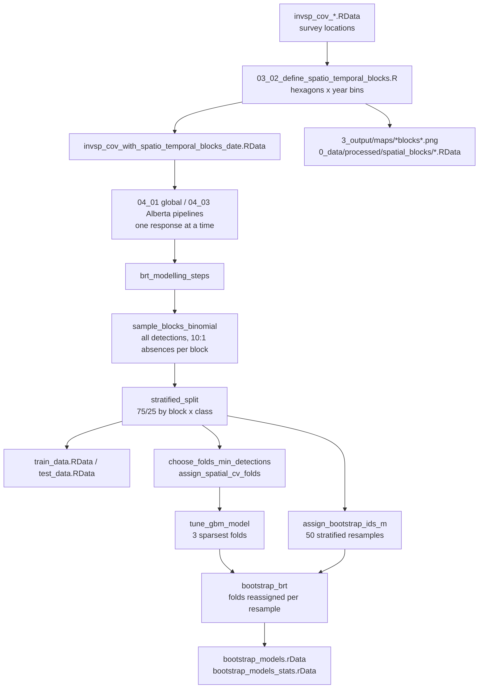
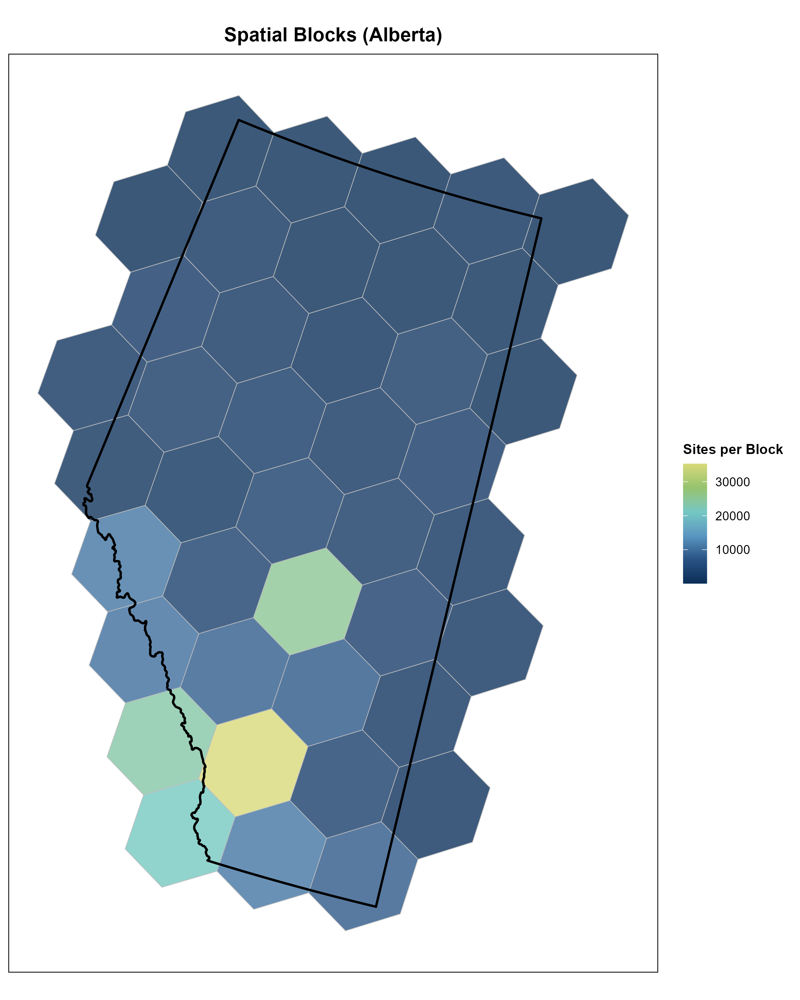
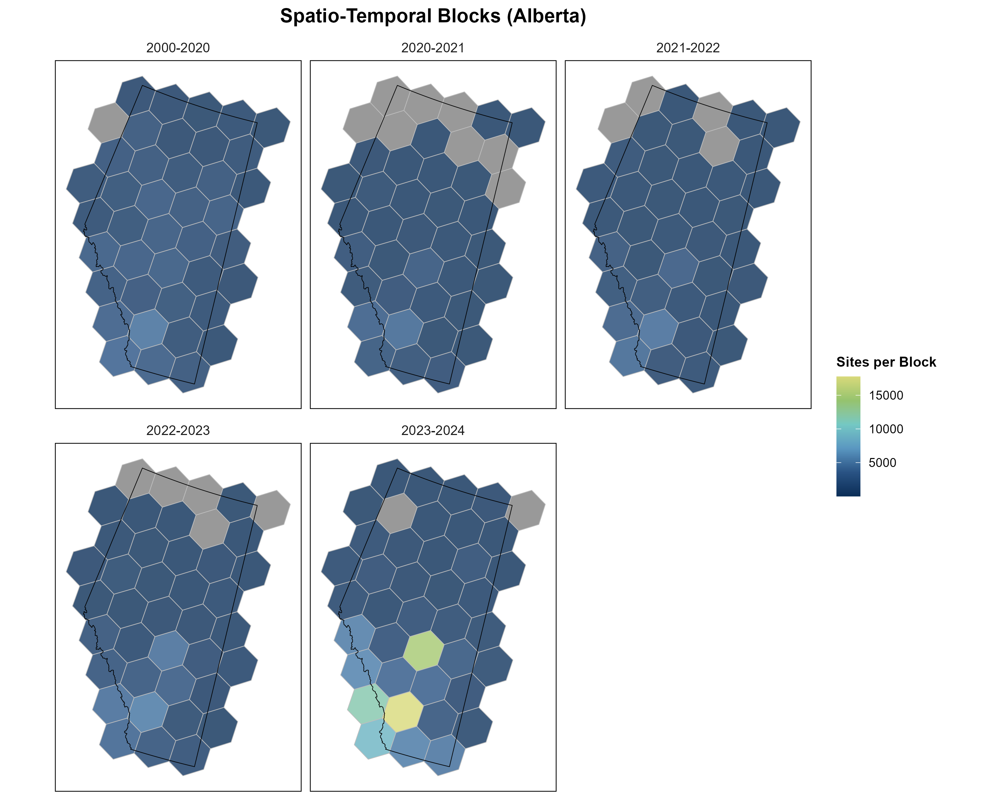

# Spatio-temporal block stratification and absence subsampling

## Overview

Invasive plant occurrence data are spatially and temporally clustered. Survey effort is concentrated near roads, in certain regions, and in recent years, and detections of a given species are often confined to a small part of the study area. Unstratified resampling of such data can produce training, validation, and bootstrap sets that over-represent well-surveyed places and periods. We address this by assigning every survey location to a spatio-temporal block (a 150-km hexagonal grid cell crossed with a quantile-based year bin) and using those blocks as the stratification unit at every resampling stage of the boosted regression tree (BRT) pipeline.

The blocks serve two purposes. First, they define where absences are kept: we retain every detection and subsample absences to a fixed ratio within each block, discarding blocks that contain no detections. This acts as a block-level thinning of absences rather than of detections. Second, they stratify the 75/25 training–test split, the cross-validation (CV) folds used for tuning and model fitting, and the 50 bootstrap resamples. However, the implementation distributes each block's rows across all folds instead of holding whole blocks out, so the CV is block-stratified rather than block-independent (see Drawbacks and limitations).

The method comes from the `invasive_species_indicator` project. Code snippets are labelled with their paths in that repository and were copied from it on 2026-11-15. The four helper functions the examples need are copied into `R/` so the vignette runs on its own. The source repository remains the authoritative version.

| Inputs | Outputs | Languages and platforms | Run time |
|---|---|---|---|
| Survey locations with longitude, latitude, year, and 0/1 response per species (`invsp_cov_*.RData`) | Block-labelled data (`invsp_cov_with_spatio_temporal_blocks_<date>.RData`), block geometries, block maps, and per-species training and test sets, tuned parameters, and 50 bootstrap BRT models | R | `[not stated]` |

## Workflow at a glance

1. Build spatial blocks from a global hexagonal grid (150-km spacing) and temporal blocks from five quantile-based year bins, then combine them into spatio-temporal blocks (`03_02`).
2. For each species, keep all detections and subsample absences at 10 per detection (minimum 2) within each block, dropping blocks with no detections (`sample_blocks_binomial()`).
3. Split the subsampled data 75/25 into training and test sets, stratified by block and class (`stratified_split()`).
4. Choose the largest fold count that gives each fold a minimum number of detections, then assign folds within each block × class group (`choose_folds_min_detections()`, `assign_spatial_cv_folds()`).
5. Tune BRT hyperparameters using the three folds with the fewest detections (`tune_gbm_model()`).
6. Draw 50 block × class stratified bootstrap resamples of the training data and fit one BRT per resample, with folds reassigned per resample (`assign_bootstrap_ids_m()`, `bootstrap_brt()`).



## Requirements

- R and packages. Block construction uses `tidyverse`, `dggridR`, `rnaturalearth`, `sf`, `MetBrewer`, and `scales` (`03_02`). Sampling and resampling use `dplyr`, `purrr`, `rlang`, and `glue`. Model fitting uses `gbm`, `dismo`, `pROC`, `foreach`, `doParallel`, and `doRNG` (for `%dorng%`). Package versions are `[not specified in code]`. The dummy-data examples below were run with R 4.5.0, `dggridR` 3.1.0, `dplyr` 1.1.4, and `purrr` 1.0.4.
- Input data. `0_data/processed/species/combined/invsp_cov_*.RData`, loaded with `load_most_recent_data()`, with `longitude`, `latitude`, `year`, and one 0/1 column per species. Country and province boundaries come from `rnaturalearth` and are used only for mapping.
- Shared constants. `grouping_vars <- c("spatio_temporal_block", "fold")` is defined in `1_code/r_scripts/utils/_constants.R`.
- Compute. `tune_gbm_model()` starts an 8-core cluster and `bootstrap_brt()` a 10-core cluster. Memory and wall-clock needs are `[not specified in code]`.

### Dummy data for the examples

Each step below runs the project functions on simulated data so that the outputs can be reproduced without the occurrence data. The simulation places 3,000 survey locations across a box covering Alberta between 2000 and 2024, with detection probability increasing toward the south-east so that some blocks have many detections and others have none. Run it from this vignette's folder (`vignettes/spatio_temporal_blocking/`). The same code is in `example.R`, which runs end to end.

```r
library(dplyr)
library(purrr)
library(dggridR)

source("R/sample_blocks_binomial.R")
source("R/stratified_split.R")
source("R/assign_spatial_cv_folds.R")
source("R/assign_bootstrap_ids_matrix.R")

# Simulate 3,000 survey locations across Alberta, 2000-2024.
# Detection probability rises toward the south-east so that
# some blocks have many detections and others have none.
set.seed(42)
n <- 3000
dummy <- tibble(
  longitude = runif(n, -120, -110),
  latitude  = runif(n, 49, 60),
  year      = sample(2000:2024, n, replace = TRUE)
) %>%
  mutate(
    p_det    = plogis(-3.5 + 0.35 * (60 - latitude) / 2 +
                        0.2 * (longitude + 120) / 2),
    presence = rbinom(n, 1, p_det)
  ) %>%
  select(-p_det)
```

The example chunks in Steps 1–4 and 6 continue from this chunk and must be run in order.

## Step-by-step

### Step 1: Build spatial and temporal blocks

We build spatial blocks from a global discrete grid of hexagons rather than a projected rectangular grid, so that cells have approximately equal area across Canada and the contiguous United States. `dgconstruct()` picks the grid resolution whose cell-centre spacing is closest to 150 km, and `dgGEO_to_SEQNUM()` returns the ID of the cell containing each survey location. Temporal blocks bin survey years at the 20th, 40th, 60th, and 80th percentiles, so each bin holds roughly one fifth of the observations, not one fifth of the years. The spatio-temporal block is the observed combination of the two, renumbered as `block_1`, `block_2`, and so on.

`1_code/r_scripts/03_02_define_spatio_temporal_blocks.R` (lines 94–97)

```r
grid <- dgconstruct(
  spacing = 150,
  metric = TRUE
)
```

`1_code/r_scripts/03_02_define_spatio_temporal_blocks.R` (lines 100–138)

```r
invsp_cov <- invsp_cov %>%
  mutate(
    # Assign points to spatial blocks using the precomputed grid
    spatial_block = dgGEO_to_SEQNUM(
      grid,
      longitude,
      latitude
    )$seqnum,
    # Create quantile-based temporal blocks
    temporal_block = cut(
      year,
      breaks = quantile(
        year,
        probs = seq(0, 1, by = 0.2),
        na.rm = TRUE
      ),
      include.lowest = TRUE,
      right = FALSE
    ),
    # Combine spatial and temporal blocks
    spatio_temporal_block = interaction(
      droplevels(as.factor(spatial_block)),
      droplevels(as.factor(temporal_block)),
      sep = "::",
      drop = TRUE
    )
  ) %>%
  # ...
  group_by(spatio_temporal_block) %>%
  mutate(
    spatio_temporal_block = paste0(
      "block_", cur_group_id()
    )
  ) %>%
  ungroup()
```

The block assignment runs once on the combined Canada and United States dataset, so the year breaks reflect the continental distribution of survey years, and the Alberta pipeline inherits them. The methods prose reports 39 spatial blocks in Alberta (median 1,440 observations per block), 171 spatio-temporal blocks in Alberta, and 3,714 across Canada and the contiguous United States. These counts come from the prose and are not reproduced by any script reviewed here.

With the dummy data, the same code gives 45 spatial blocks and 222 spatio-temporal blocks across 3,000 observations, with about 600 observations in each year bin.

```r
grid <- dgconstruct(spacing = 150, metric = TRUE)

dummy <- dummy %>%
  mutate(
    spatial_block = dgGEO_to_SEQNUM(grid, longitude, latitude)$seqnum,
    temporal_block = cut(
      year,
      breaks = quantile(year, probs = seq(0, 1, by = 0.2), na.rm = TRUE),
      include.lowest = TRUE,
      right = FALSE
    ),
    spatio_temporal_block = interaction(
      droplevels(as.factor(spatial_block)),
      droplevels(as.factor(temporal_block)),
      sep = "::",
      drop = TRUE
    )
  ) %>%
  group_by(spatio_temporal_block) %>%
  mutate(spatio_temporal_block = paste0("block_", cur_group_id())) %>%
  ungroup()

dummy %>%
  summarise(
    n_obs = n(),
    n_detections = sum(presence),
    n_spatial_blocks = n_distinct(spatial_block),
    n_spatio_temporal_blocks = n_distinct(spatio_temporal_block)
  ) %>%
  print()
print(table(dummy$temporal_block))
```

```text
# A tibble: 1 × 4
  n_obs n_detections n_spatial_blocks n_spatio_temporal_blocks
  <int>        <int>            <int>                    <int>
1  3000          381               45                      222

[2000,2005) [2005,2010) [2010,2015) [2015,2020) [2020,2024] 
        597         592         575         621         615 
```

**Decision point.** The 150-km spacing (D1) was chosen to approximate the extent of Alberta's Natural Subregions, trading block independence against the number of observations per block. Five quantile-based year bins (D2) balance sample size across periods at the cost of unequal bin widths. See Key decision points.

**Outputs.** `2_pipeline/invsp_cov_with_spatio_temporal_blocks_<date>.RData`, block geometries in `0_data/processed/spatial_blocks/` (`spatial_blocks_<date>.RData` and `spatial_temporal_blocks_<date>.RData`), and four block maps in `3_output/maps/`.





### Step 2: Subsample absences within blocks

`brt_modelling_steps()` receives the block-labelled data for one species and first subsamples absences within each spatio-temporal block. Blocks with no detections of the species are removed. Within each remaining block, every detection is kept and absences are drawn without replacement up to `max(ratio * n_det, min_absences)`, capped at the number of absences available. With `ratio = 10` and `min_absences = 2`, a block with 3 detections keeps up to 30 absences, and a block with 1 detection keeps up to 10.

`1_code/r_scripts/utils/brt_modelling_steps.R` (lines 80–86)

```r
  data <- sample_blocks_binomial(
    data,
    block_column = "spatio_temporal_block",
    response_column = response_var,
    ratio = 10,
    min_absences = 2
  )
```

`1_code/r_scripts/utils/sample_blocks_binomial.R` (lines 75–84)

```r
  sampled <- lapply(blocks, function(.x) {
    det <- .x[.x[[response_column]] == 1, , drop = FALSE]
    ps_abs <- .x[.x[[response_column]] == 0, , drop = FALSE]
    n_det <- nrow(det)
    n_ps_abs <- nrow(ps_abs)
    n_sample_abs <- min(n_ps_abs, max(ratio * n_det, min_absences))
    if (n_sample_abs == 0) return(det)
    ps_abs_sample <- ps_abs[sample(n_ps_abs, n_sample_abs), , drop = FALSE]
    rbind(det, ps_abs_sample)
  })
```

Because absences are capped per block, well-surveyed blocks with few detections contribute far fewer absences than they hold. Dropping blocks without detections restricts the model's absences to blocks where the species was found at least once. This conditions the model on the species' observed range (in space and time), so absences from outside that range are not available to inform the response. The function also accepts a `max_sample_size` cap with proportional downsampling (lines 89–111), but `brt_modelling_steps()` does not pass it.

With the dummy data, subsampling drops 60 of the 222 blocks and 801 absences while keeping all 381 detections.

```r
model_data <- dummy %>%
  select(presence, spatio_temporal_block, longitude, latitude, year)

sampled <- sample_blocks_binomial(
  model_data,
  block_column = "spatio_temporal_block",
  response_column = "presence",
  ratio = 10,
  min_absences = 2
)

bind_rows(
  model_data %>% mutate(stage = "before"),
  sampled %>% mutate(stage = "after")
) %>%
  group_by(stage) %>%
  summarise(
    n_blocks = n_distinct(spatio_temporal_block),
    detections = sum(presence == 1),
    absences = sum(presence == 0),
    .groups = "drop"
  ) %>%
  arrange(desc(stage)) %>%
  print()
```

```text
# A tibble: 2 × 4
  stage  n_blocks detections absences
  <chr>     <int>      <int>    <int>
1 before      222        381     2619
2 after       162        381     1818
```

**Decision point.** The absence-to-detection ratio (D3), the minimum absences per block (D4), and dropping blocks without detections (D5) together set the prevalence of the modelling data and the spatial and temporal extent of the absences.

**Outputs.** An in-memory data frame of all detections and the subsampled absences.

### Step 3: Split training and test data by block

The subsampled data are split into training (75%) and test (25%) sets within each block × class group, so every block contributes detections and absences to both sets where group size allows. Within each group, `round(train_frac * n)` rows are drawn for training.

`1_code/r_scripts/utils/brt_modelling_steps.R` (lines 90–95)

```r
  data <- stratified_split(
    data = data,
    block_column = "spatio_temporal_block",
    class_column = response_var,
    train_frac = 0.75
  )
```

`1_code/r_scripts/utils/stratified_split.R` (lines 37–54)

```r
  data %>%
    group_by(
      !!sym(block_column), 
      !!sym(class_column)
    ) %>%
    group_split() %>%
    map_dfr(~ {
      n <- nrow(.x)
      train_size <- round(train_frac * n)
      .x %>%
        mutate(
          split = ifelse(
            row_number() %in% sample(1:n, train_size), 
            "train", 
            "test"
          )
        )
    })
```

Rounding is applied per group, so small groups are always assigned to training: `round(0.75 * 1)` and `round(0.75 * 2)` both send every row to training. Blocks with one or two detections never contribute detections to the test set, and the realized training fraction for detections is higher than 75%.

With the dummy data, 82% of detections (313 of 381) and 76% of absences (1,383 of 1,818) go to training.

```r
split_data <- stratified_split(
  data = sampled,
  block_column = "spatio_temporal_block",
  class_column = "presence",
  train_frac = 0.75
)
print(table(split = split_data$split, presence = split_data$presence))

train_data <- split_data %>% filter(split == "train") %>% select(-split)
```

```text
       presence
split      0    1
  test   435   68
  train 1383  313
```

**Decision point.** The training fraction (D6) sets the size of the held-out test set used for the `_test` evaluation metrics in `bootstrap_brt()`.

**Outputs.** `train_data.RData` and `test_data.RData` in `pipeline_dir`.

### Step 4: Choose the number of folds and assign them

The fold count is chosen per species. `choose_folds_min_detections()` counts detections per block and tests fold counts from `min(max_folds, max(detections in any block))` downward, returning the first `k` at which every fold receives at least `min_detections` detections. It falls back to 1 fold if no `k` between `min_folds` (default 2) and the cap works. The per-fold count mirrors how `assign_spatial_cv_folds()` deals fold IDs within each group: a block with `c` detections contributes `floor((c - f) / k) + 1` detections to fold `f` when `c >= f`, and none otherwise.

`1_code/r_scripts/utils/brt_modelling_steps.R` (lines 198–204)

```r
  folds <- choose_folds_min_detections(
    data = train_data,
    block_column = "spatio_temporal_block",
    class_column = response_var,
    min_detections = 25, # 250 for global, 25 regional
    max_folds = 5 # 10 for global, 5 for regional
  )
```

`1_code/r_scripts/utils/assign_spatial_cv_folds.R` (lines 60–89)

```r
  fold_cap <- min(max_folds, max(det_counts$n_detect))
  best <- NA_integer_

  check_folds <- function(k) {
    counts <- det_counts$n_detect
    vapply(
      seq_len(k),
      function(fold_idx) {
        contrib <- ifelse(
          counts >= fold_idx,
          floor((counts - fold_idx) / k) + 1L,
          0L
        )
        as.integer(sum(contrib))
      },
      integer(1)
    )
  }

  for (k in seq(
    from = fold_cap,
    to = min_folds,
    by = -1
  )) {
    per_fold <- check_folds(k)
    if (min(per_fold) >= min_detections) {
      best <- k
      break
    }
  }
```

Folds are then assigned within each block × class group by shuffling the sequence `1, 2, …, k, 1, 2, …` of the group's length. Every block with at least `k` rows of a class appears in every fold, so the folds are stratified by block but do not hold blocks out.

`1_code/r_scripts/utils/assign_spatial_cv_folds.R` (lines 152–167)

```r
  data %>%
    dplyr::group_by(
      !!sym(block_column),
      !!sym(class_column)
    ) %>%
    dplyr::group_split() %>%
    purrr::map_dfr(
      ~{
        n <- nrow(.x)
        fold_ids <- sample(
          rep(seq_len(n_folds), length.out = n)
        )
        .x %>%
          dplyr::mutate(fold = fold_ids)
      }
    )
```

When a group has fewer rows than `k`, the sequence is truncated, so only the lowest fold numbers are used. Most blocks hold one or two detections, so fold 1 collects a disproportionate share of detections and the highest-numbered fold the fewest.

With the dummy data, the function picks 3 folds. Detections fall unevenly across them (172, 109, and 32), and 157 of the 160 blocks with at least 3 training rows appear in all 3 folds.

```r
folds <- choose_folds_min_detections(
  data = train_data,
  block_column = "spatio_temporal_block",
  class_column = "presence",
  min_detections = 25,
  max_folds = 5
)
print(folds)

train_data <- assign_spatial_cv_folds(
  data = train_data,
  block_column = "spatio_temporal_block",
  class_column = "presence",
  n_folds = folds
)

train_data %>%
  group_by(fold) %>%
  summarise(
    detections = sum(presence == 1),
    absences = sum(presence == 0),
    n_blocks = n_distinct(spatio_temporal_block),
    .groups = "drop"
  ) %>%
  print()

train_data %>%
  group_by(spatio_temporal_block) %>%
  summarise(n_folds_in_block = n_distinct(fold), n = n(), .groups = "drop") %>%
  filter(n >= folds) %>%
  count(n_folds_in_block, name = "n_blocks") %>%
  print()
```

```text
[1] 3

# A tibble: 3 × 4
   fold detections absences n_blocks
  <int>      <int>    <int>    <int>
1     1        172      514      162
2     2        109      477      161
3     3         32      392      157

# A tibble: 2 × 2
  n_folds_in_block n_blocks
             <int>    <int>
1                2        3
2                3      157
```

**Decision point.** The minimum detections per fold and the fold cap (D7) set how many folds each species gets for tuning. The bootstrap step uses a separate, stricter pair (D11).

**Outputs.** A `fold` column on `train_data`.

### Step 5: Tune hyperparameters on the folds with the fewest detections

Before tuning, `brt_modelling_steps()` keeps only the three folds with the fewest detections, renumbers them 1–3, and passes them to `tune_gbm_model()` as a 3-fold CV design. This shrinks the tuning dataset and runs the search on the sparsest detection folds. When the species has 3 or fewer folds, all of the training data are used.

`1_code/r_scripts/utils/brt_modelling_steps.R` (lines 221–249)

```r
  if (TRUE) {
    # Select the three folds with the fewest detections to
    # determine the number of folds for tuning
    det_by_fold <- train_data %>%
      dplyr::group_by(fold) %>%
      dplyr::summarise(
        n_detect = sum(.data[[response_var]] == 1),
        .groups = "drop"
      )

    n_select <- min(3, nrow(det_by_fold))
    selected_folds <- det_by_fold %>%
      dplyr::slice_min(
        order_by = n_detect,
        n = n_select,
        with_ties = FALSE
      ) %>%
      dplyr::pull(fold)

    tuning_data <- train_data %>%
      dplyr::filter(fold %in% selected_folds) %>%
      dplyr::mutate(
        fold = match(fold, selected_folds)
      ) %>%
      as.data.frame()
    # ...
  }
```

`tune_gbm_model()` fits `gbm.step()` once per combination in a 24-row grid, passing the fold vector so the CV follows the block-stratified folds, and ranks combinations by mean CV deviance.

`1_code/r_scripts/utils/tune_gbm_model.R` (lines 38–45)

```r
  hyper_grid <- expand.grid(
    learning.rate = c(.005, .01),
    tree.complexity = c(1, 2),
    n.minobsinnode = c(10, 20, 30),
    bag.fraction = c(0.5, 0.75),
    optimal_trees = 0, # Placeholder for results
    mean_deviance = 0 # Placeholder for results
  )
```

We do not run the tuning on the dummy data because it depends on the full predictor set and a parallel cluster.

**Decision point.** Tuning on the three sparsest folds (D8) and the hyperparameter grid (D9).

**Outputs.** `tuned_param.rData` in `model_dir`. Its first row (lowest mean deviance) is used for bootstrap fitting.

### Step 6: Stratified bootstrap and per-replicate cross-validation

Bootstrap indices are drawn with replacement within each block × class group of the training data. Because `max_sample_size` equals `nrow(train_data)`, the sampling proportion is 1 and each group is resampled to its own size, preserving the class balance and block composition of the training set in every replicate.

`1_code/r_scripts/utils/brt_modelling_steps.R` (lines 170–179)

```r
  bootstrap_ids <- assign_bootstrap_ids_m(
    data = train_data,
    block_column = "spatio_temporal_block",
    class_column = response_var,
    num_boot = 50,
    max_sample_size = nrow(train_data),
    seed = 123,
    replace = TRUE,
    progress = FALSE
  )
```

`1_code/r_scripts/utils/assign_bootstrap_ids_matrix.R` (lines 85–90 and 101–112)

```r
  # Step 3: Calculate dynamic proportion ----
  prop <- min(1, max_sample_size / total_group_size)
  
  # Step 4: Determine sample sizes ----
  sample_sizes <- pmax(1, floor(group_sizes * prop))
  total_sample_size <- sum(sample_sizes)
  # ...
  sample_one <- function() {
    unlist(
      mapply(function(ix, m) {
        ix[sample.int(
          n = length(ix),
          size = m,
          replace = replace
        )]
      }, group_indices, sample_sizes, SIMPLIFY = FALSE),
      use.names = FALSE
    )
  }
```

`bootstrap_brt()` runs the iterations in parallel. In each one it selects the resampled rows, chooses a fold count with at least 200 detections per fold (up to 10 folds), reassigns block-stratified folds, and fits a BRT with the tuned parameters. Training and test metrics are computed for each model, and the 50 models are later combined into a median model with `ensemble_pred_stats()`.

`1_code/r_scripts/utils/bootstrap_brt.R` (lines 60–70)

```r
  run_iteration <- function(iter) {
    # Step 4.1: Select rows for the current bootstrap iteration ----
    train_data <- train_data[bootstrap_ids[, 1], ]

    folds <- choose_folds_min_detections(
      data = train_data,
      block_column = "spatio_temporal_block",
      class_column = response_var,
      min_detections = 200,
      max_folds = 10
    )
```

Line 62 indexes column 1 of `bootstrap_ids` in every iteration, so all 50 models are fitted to the same resample. They differ only in fold assignment and in the random row subsampling `gbm` does through `bag.fraction`. The corrected line indexes the current iteration:

```r
    train_data <- train_data[bootstrap_ids[, iter], ]
```

With the dummy data, the index matrix has one row per training row and one column per replicate. Replicate 1 contains 1,147 distinct rows (about 68%), slightly above the 63% expected for an unstratified bootstrap because single-row groups are always retained. No other column is identical to it, which confirms that the resamples differ and that only the indexing in `bootstrap_brt()` needs to change.

```r
bootstrap_ids <- assign_bootstrap_ids_m(
  data = train_data,
  block_column = "spatio_temporal_block",
  class_column = "presence",
  num_boot = 50,
  max_sample_size = nrow(train_data),
  seed = 123,
  replace = TRUE,
  progress = FALSE
)
print(dim(bootstrap_ids))
cat("Unique rows in replicate 1:",
    length(unique(bootstrap_ids[, 1])), "of", nrow(train_data), "\n")
cat("Replicates identical to replicate 1:",
    sum(apply(bootstrap_ids, 2, identical, bootstrap_ids[, 1])), "of 50\n")
```

```text
[1] 1696   50
Unique rows in replicate 1: 1147 of 1696 
Replicates identical to replicate 1: 1 of 50
```

**Decision point.** The number of replicates, resampling with replacement, and the resample size (D10), and the detection threshold and fold cap used inside each replicate (D11).

**Outputs.** `bootstrap_models.rData`, `bootstrap_models_stats.rData` (mean and standard deviation of the evaluation metrics, plus variable-importance consistency and Kendall's W), and `global_bootstrap_model.rData` (median model) in `model_dir`.

## Key decision points

| ID | Decision | Options | Choice in code | Rationale | Effect on results |
|---|---|---|---|---|---|
| D1 | Spatial block size | Smaller or larger hexagons; ecological units (e.g. Natural Subregions); range-based block size from residual autocorrelation | `spacing = 150` (`03_02`, line 95) | Approximates the extent of Alberta's Natural Subregions; balances independence against observations per block (prose) | Larger blocks give fewer, better-filled strata. Smaller blocks give finer stratification but more blocks with few rows, which pushes fold assignment toward fold 1 |
| D2 | Temporal blocking | Fixed-width bins (e.g. 5-year); fewer or more quantile bins; no temporal blocking | 5 quantile bins, `probs = seq(0, 1, by = 0.2)`, breaks from the continental data (`03_02`, lines 109–118) | Balanced sample size across periods (implied by quantile design) `[not stated]` | Recent years with dense effort get narrower bins. Bin edges depend on the combined dataset and shift as data are added |
| D3 | Absence-to-detection ratio | 1:1 up to all absences; prevalence-matched ratio | `ratio = 10` (`brt_modelling_steps.R`, line 84) | `[not stated]` | Sets modelled prevalence at no less than about 9% (1 in 11), which shifts predicted probabilities. Higher ratios retain more environmental contrast |
| D4 | Minimum absences per block | 0 or more | `min_absences = 2` (`brt_modelling_steps.R`, line 85) | `[not stated]` | Has no effect when the ratio already gives at least 2, so it only acts for blocks with no detections, which D5 removes. In practice it is inactive |
| D5 | Drop blocks without detections | Keep all blocks; keep a sample of absence-only blocks | Always dropped (`sample_blocks_binomial.R`, lines 57–68) | `[not stated]` | Conditions the model on the observed range of the species in space and time, which removes contrast from unoccupied areas |
| D6 | Training–test split | Fraction; block hold-out split | `train_frac = 0.75`, stratified by block × class (`brt_modelling_steps.R`, line 94) | `[not stated]` | Per-group rounding sends small detection groups to training (82% of detections in the dummy example) |
| D7 | Fold selection for tuning | Detection thresholds and fold caps | `min_detections = 25`, `max_folds = 5` (`brt_modelling_steps.R`, lines 202–203) | Comment states 250 and 10 for the global model, 25 and 5 for regional | Sets the number of tuning folds. The global pipeline currently runs with the regional values |
| D8 | Tuning subset | All folds; 3 sparsest folds | 3 folds with the fewest detections (`if (TRUE)`, `brt_modelling_steps.R`, lines 221–249) | Reduce tuning cost (implied) `[not stated]` | Tuning sees a sparse subset and may favour simpler or more regularized settings than the full data would support |
| D9 | Hyperparameter grid | Wider ranges; random or Bayesian search | 2 learning rates × 2 tree complexities × 3 `n.minobsinnode` × 2 bag fractions (`tune_gbm_model.R`, lines 38–45) | `[not stated]` | Tree complexity of 1 or 2 limits interaction depth |
| D10 | Bootstrap design | Replicate count; with or without replacement; resample size | `num_boot = 50`, `replace = TRUE`, `max_sample_size = nrow(train_data)`, `seed = 123` (`brt_modelling_steps.R`, lines 170–179) | `[not stated]` | 50 replicates give coarse percentile intervals. Block × class stratification keeps composition fixed across replicates |
| D11 | Fold selection within bootstrap | Same as D7; per-model thresholds | `min_detections = 200`, `max_folds = 10` (`bootstrap_brt.R`, lines 64–70) | `[not stated]` | For rare species, no fold count of 2 or more may reach 200 detections, which falls back to 1 fold |

## Drawbacks and limitations

- The bootstrap reuses one resample. `bootstrap_brt.R` line 62 indexes `bootstrap_ids[, 1]` instead of `bootstrap_ids[, iter]`. All 50 models train on the same rows, so the bootstrap standard deviations, prediction uncertainty, and the stability metrics (consistency and Kendall's W) reflect only fold and bagging variation and probably understate uncertainty. Mitigation: change the index to `iter` and rerun the models.
- The CV is block-stratified, not spatially independent. `assign_spatial_cv_folds()` spreads each block's rows across all folds, and `stratified_split()` does the same for the test set. Training and validation rows come from the same 150-km cells and year bins, so CV deviance and test metrics are likely optimistic for prediction to new areas or periods `[citation needed]`. This conflicts with the methods prose, which states that block size balances "spatial independence" and that the blocks ensure "balanced geographic and temporal representation". The second claim matches the code, but the first does not. Alternative: assign whole blocks to folds (block-level k-fold or leave-block-out CV, e.g. with `blockCV`) and choose block size from residual spatial autocorrelation.
- Detections pile into fold 1. Groups smaller than `k` receive only the lowest fold numbers, so fold 1 collects most detections from sparse blocks (172, 109, and 32 detections across 3 folds in the dummy example). Fold-level validation statistics are therefore not comparable across folds, and the 3 sparsest folds used for tuning (D8) may be much sparser than the training set as a whole. Alternative: shuffle fold IDs across groups, for example by starting each group's sequence at a random offset.
- Small detection groups never reach the test set. Per-group rounding in `stratified_split()` sends blocks with one or two detections entirely to training. The test set over-represents dense blocks, so test metrics describe performance where the species is common.
- The fold thresholds don't match their comments. `brt_modelling_steps()` fixes `min_detections = 25` and `max_folds = 5`, with a comment giving 250 and 10 for the global model. The global (`04_01`) and Alberta (`04_03`) pipelines both call the same function, so the global model is tuned with the regional values. Mitigation: expose both as arguments of `brt_modelling_steps()` and set them per pipeline.
- The Alberta pipeline splits twice. `04_03_nsdm_modelling_pipeline_alberta.R` (lines 372–377) runs `stratified_split()` before calling `brt_modelling_steps()`, which subsamples and splits again. The first `split` column is dropped by the column selection in `brt_modelling_steps()` (lines 67–74), so it has no effect, but it can mislead readers about which split is used.
- Rare species may fall back to 1 fold. If no fold count of 2 or more gives 200 detections per fold, `choose_folds_min_detections()` returns 1. Whether `gbm.step()` can fit with a single fold is `[not specified in code]`, and a failed fit returns `NULL` and is recorded as an `NA` row.
- Absence subsampling restricts the environmental contrast. Dropping blocks without detections (D5) removes absences from unoccupied parts of the study area. This may weaken the response to predictors that separate occupied from unoccupied regions and may raise predicted probabilities outside the sampled range. A modest sample of absence-only blocks would retain that contrast.
- Fixed hexagons ignore ecological boundaries. The global grid layout fixes the hexagon positions, so cells straddle Natural Subregion and provincial boundaries regardless of the 150-km rationale. Block counts within Alberta depend on how cells intersect the provincial boundary.
- Year breaks can be unstable. Year breaks come from the combined continental dataset and change when data are added, and duplicated quantiles in heavily surveyed years would cause `cut()` to fail. Block IDs (`block_<n>`) are renumbered on every run, so they are not comparable across dated outputs.
- Unused options. `sample_blocks_binomial()` supports a `max_sample_size` cap that `brt_modelling_steps()` never passes, and `min_absences = 2` is effectively inactive (D4).
- Unchecked counts. The prose counts (39 and 171 blocks in Alberta, 3,714 across Canada and the contiguous United States, and a median of 1,440 observations per spatial block) could not be reproduced from the scripts reviewed. They should be regenerated from `0_data/processed/spatial_blocks/` before publication.

## Code provenance

| Script | Role | Steps |
|---|---|---|
| `1_code/r_scripts/03_02_define_spatio_temporal_blocks.R` | Builds the hexagonal grid and year bins, labels observations with spatio-temporal blocks, and saves block geometries and maps | 1 |
| `1_code/r_scripts/04_01_nsdm_modelling_pipeline_global.R` | Calls `brt_modelling_steps()` for the continental model | 2–6 |
| `1_code/r_scripts/04_03_nsdm_modelling_pipeline_alberta.R` | Runs a preliminary split and calls `brt_modelling_steps()` for the Alberta model | 2–6 |
| `1_code/r_scripts/utils/brt_modelling_steps.R` | Orchestrates sampling, splitting, fold choice, tuning, bootstrap, and median-model steps, and sets most parameters | 2–6 |
| `1_code/r_scripts/utils/sample_blocks_binomial.R` | Keeps all detections and subsamples absences per block, dropping blocks without detections | 2 |
| `1_code/r_scripts/utils/stratified_split.R` | Block × class stratified training–test split | 3 |
| `1_code/r_scripts/utils/assign_spatial_cv_folds.R` | `choose_folds_min_detections()` and `assign_spatial_cv_folds()` | 4, 6 |
| `1_code/r_scripts/utils/tune_gbm_model.R` | Grid search over BRT hyperparameters with `gbm.step()` | 5 |
| `1_code/r_scripts/utils/assign_bootstrap_ids_matrix.R` | Block × class stratified bootstrap index matrix | 6 |
| `1_code/r_scripts/utils/bootstrap_brt.R` | Fits one BRT per bootstrap replicate with per-replicate folds | 6 |
| `1_code/r_scripts/utils/_constants.R` | Defines `grouping_vars` | 2–6 |
