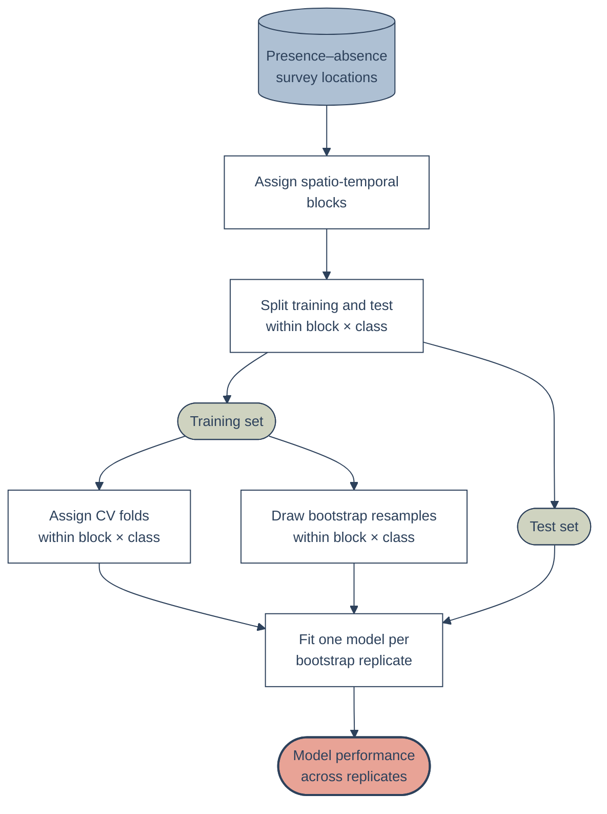
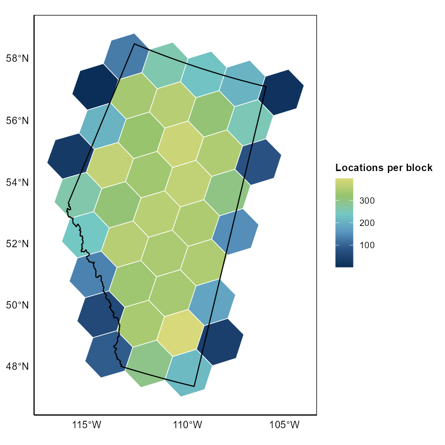
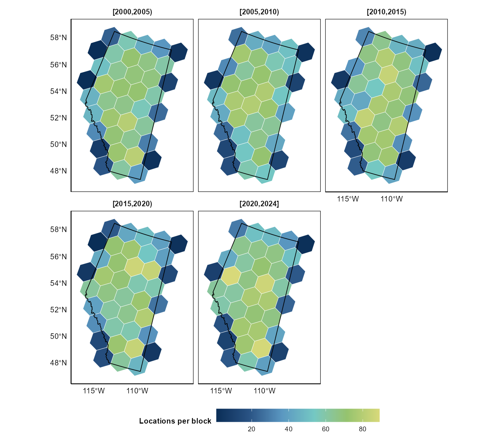
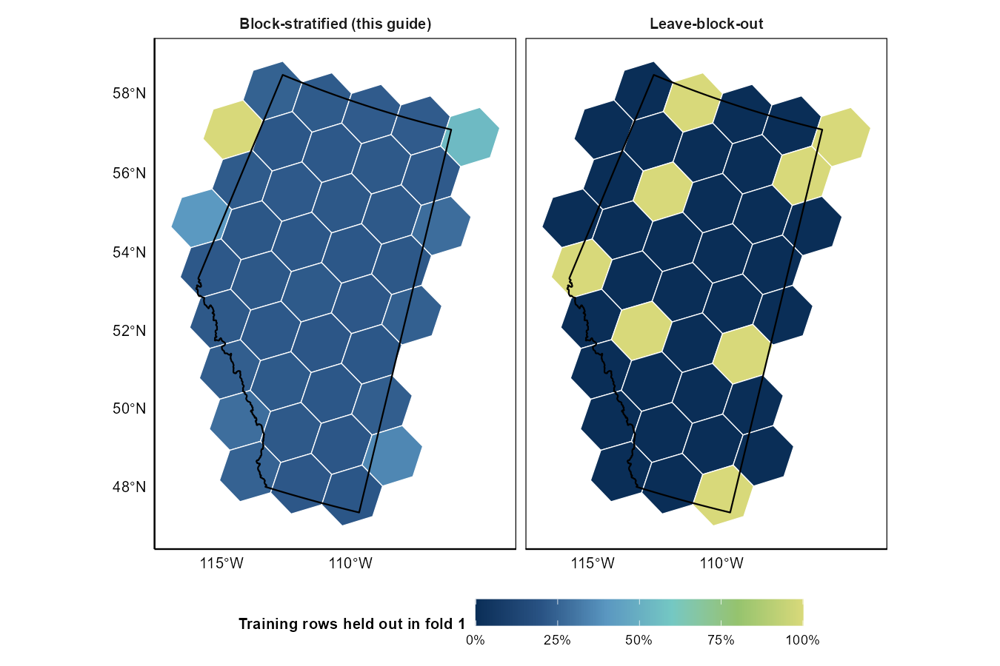

# Spatio-temporal stratification of survey locations

## Overview

Species survey data are rarely spread evenly in space or time. E.g. effort may concentrate near roads, in particular regions, and in recent years, and detections of a given species often come from a small part of the study area. Unstratified resampling of such data can produce training, validation, and bootstrap sets that over-represent well-surveyed places and periods. Here we describe methods to address these problems by spatially stratifying data. The method assigns every survey location to a spatio-temporal block (an equal-area hexagonal cell crossed with a quantile-based year bin) and uses those blocks as the stratification unit at each resampling stage of a presence–absence modelling workflow.

The blocks stratify the training–test split, the cross-validation (CV) folds, and the bootstrap resamples. Each is drawn within every combination of block and response class (detection or absence), so every subset keeps roughly the same mix of detections and absences from each block as the full data. The method assumes presence–absence data, where every survey location records whether the species was detected. The folds are block-stratified rather than block-independent, which matters for how CV error should be read (see Drawbacks and limitations).

| Inputs                                                                               | Outputs                                                                                     | Languages and platforms |
| ------------------------------------------------------------------------------------ | ------------------------------------------------------------------------------------------- | ----------------------- |
| Presence–absence survey locations with longitude, latitude, year, and a 0/1 response | Block labels per location, a training–test split, CV fold IDs, and a bootstrap index matrix | R                       |


## Workflow at a glance

1. Build spatial blocks from a global hexagonal grid (150-km spacing) and temporal blocks from five quantile-based year bins, then combine them into spatio-temporal blocks.
2. Split the data 75/25 into training and test sets within each block × class group.
3. Choose the largest number of folds that gives every fold a minimum number of detections, then assign folds within each block × class group.
4. Draw bootstrap resamples with replacement within each block × class group.
5. Fit one model per bootstrap replicate, using the folds for cross-validation and the test set for evaluation.



## Requirements

The example was run with R 4.5.0 and the packages below.

| Package | Version | Used for |
|---|---|---|
| `dplyr`, `purrr`, `tidyr` | 1.1.4, 1.0.4, 1.3.1 | Data manipulation and iteration |
| `dggridR` | 3.1.0 | Hexagonal grid and spatial block IDs |
| `sf` | 1.1.2 | Sampling locations, block polygons, and reprojection |
| `rnaturalearth`, `rnaturalearthhires` | 1.1.0, 1.0.0.9000 | Alberta boundary |
| `ggplot2`, `MetBrewer` | 4.0.3, 0.2.0 | Block maps |
| `utilR` | 0.1.0 | `theme_science_map()` for the maps (github.com/bgcasey/utilR) |

`rnaturalearthhires` and `utilR` are not on CRAN. Install them from GitHub (`remotes::install_github("ropensci/rnaturalearthhires")` and `remotes::install_github("bgcasey/utilR")`).

The method needs presence–absence survey data with one row per location–visit and columns for longitude and latitude (WGS84), year, and a 0/1 response. The below functions take the response through `class_column`, and each value (detection or absence) is treated as a class when stratifying. The example simulates the survey data. The code chunks below run in order in a single R session, and the function definitions in each step must be run before the calls that follow them. The maps are written to a `figures/` folder in the working directory. The complete script is in `example.R`.

### Simulated survey data

We simulate 10,000 presence–absence survey locations distributed randomly within the Alberta boundary between 2000 and 2024. Detection probability increases toward the south-east so that some blocks have many detections and others have none.

```r
library(dplyr)          # data manipulation
library(purrr)          # iteration (map_dfr, map_dbl)
library(ggplot2)        # block maps
library(sf)             # spatial vector data
library(dggridR)        # global hexagonal grid
library(rnaturalearth)  # provincial boundaries
library(MetBrewer)      # map colour palette
library(utilR) # theme_science_map()

# Alberta boundary (WGS84), used to place the simulated survey locations
alberta <- ne_states(country = "Canada", returnclass = "sf") %>%
  filter(name_en == "Alberta")

set.seed(42)
n <- 10000

# Draw n random points inside Alberta and extract their coordinates
locations <- st_sample(alberta, size = n) %>%
  st_coordinates()

# One row per survey: location, a random survey year, and a 0/1 detection.
# Detection probability increases toward the south (lower latitude) and
# east (higher longitude), so detections cluster in some blocks.
data <- tibble(
  longitude = locations[, "X"],
  latitude  = locations[, "Y"],
  year      = sample(2000:2024, n, replace = TRUE)
) %>%
  mutate(
    p_det    = plogis(-3.5 + 0.35 * (60 - latitude) / 2 +
                        0.2 * (longitude + 120) / 2), # probability of detection
    presence = rbinom(n, 1, p_det)  # 1 = detected, 0 = not detected
  ) %>%
  select(-p_det)
```

## Step-by-step

### Step 1: Build spatial and temporal blocks
 
Spatial blocks come from a global discrete grid of hexagons rather than a projected rectangular grid, so cells have approximately equal area across large extents. `dgconstruct()` picks the grid resolution whose cell-centre spacing is closest to the requested 150 km, and `dgGEO_to_SEQNUM()` returns the ID of the cell that contains each location. Temporal blocks bin survey years at the 20th, 40th, 60th, and 80th percentiles, so each bin holds roughly one fifth of the observations rather than one fifth of the years. The spatio-temporal block is the observed combination of the two, renumbered `block_1`, `block_2`, and so on.

```r
# Global hexagonal grid; dggridR picks the resolution whose cell-centre
# spacing is closest to 150 km
grid <- dgconstruct(
  spacing = 150,
  metric = TRUE
)

data <- data %>%
  mutate(
    # Assign points to spatial blocks using the precomputed grid
    spatial_block = dgGEO_to_SEQNUM(
      grid,
      longitude,
      latitude
    )$seqnum,
    # Create quantile-based temporal blocks
    # (breaks at the 20th, 40th, 60th, and 80th percentiles of year)
    temporal_block = cut(
      year,
      breaks = quantile(
        year,
        probs = seq(0, 1, by = 0.2),
        na.rm = TRUE
      ),
      include.lowest = TRUE,
      right = FALSE
    ),
    # Combine spatial and temporal blocks
    # (one level per observed cell x year-bin combination)
    spatio_temporal_block = interaction(
      droplevels(as.factor(spatial_block)),
      droplevels(as.factor(temporal_block)),
      sep = "::",
      drop = TRUE
    )
  ) %>%
  # Replace the long "cell::bin" labels with short IDs (block_1, block_2, ...)
  group_by(spatio_temporal_block) %>%
  mutate(
    spatio_temporal_block = paste0(
      "block_", cur_group_id()
    )
  ) %>%
  ungroup()

# Check: number of observations, detections, and blocks
data %>%
  summarise(
    n_obs = n(),
    n_detections = sum(presence),
    n_spatial_blocks = n_distinct(spatial_block),
    n_spatio_temporal_blocks = n_distinct(spatio_temporal_block)
  ) %>%
  print()
# Check: observations per year bin
print(table(data$temporal_block))
```

```text
# A tibble: 1 × 4
  n_obs n_detections n_spatial_blocks n_spatio_temporal_blocks
  <int>        <int>            <int>                    <int>
1 10000         1362               40                      197

[2000,2005) [2005,2010) [2010,2015) [2015,2020) [2020,2024] 
       1962        1960        2036        1981        2061 
```

`dgconstruct()` selects resolution 7, with cells of about 23,300 km² spaced 150.8 km apart. The 10,000 locations fall into 40 hexagons and 197 spatio-temporal blocks. Survey years are simulated uniformly, so the quantile breaks fall on 5-year intervals and each bin holds 1,960 to 2,061 locations. With real data, where effort grows over time, the bins narrow in well-surveyed periods.

To check the blocks, we convert the occupied cells to polygons and map the number of locations per block (Figures 1 and 2).

```r
dir.create("figures", showWarnings = FALSE)

# Project the boundary to Canada Atlas Lambert (EPSG:3978) for mapping
alberta_lcc <- st_transform(alberta, crs = 3978)

# Convert the occupied grid cells to polygons and project them
block_cells <- dgcellstogrid(grid, cells = unique(data$spatial_block)) %>%
  st_as_sf() %>%
  mutate(seqnum = as.integer(seqnum)) %>%
  st_transform(crs = 3978)

# Locations per spatial block
spatial_counts <- block_cells %>%
  left_join(count(data, spatial_block, name = "n_obs"),
            by = c("seqnum" = "spatial_block"))

# Figure 1: spatial blocks
p1 <- ggplot(spatial_counts) +
  geom_sf(aes(fill = n_obs), colour = "white", linewidth = 0.3) +
  geom_sf(data = alberta_lcc, fill = NA, colour = "black", linewidth = 0.5) +
  scale_fill_met_c("Hokusai3", direction = -1) +
  labs(x = NULL, y = NULL, fill = "Locations per block") +
  theme_science_map()
ggsave("figures/spatial_blocks.png", p1, width = 6, height = 6, dpi = 150)

# Locations per spatial block within each year bin (one row per
# spatio-temporal block)
st_counts <- block_cells %>%
  inner_join(count(data, spatial_block, temporal_block, name = "n_obs"),
             by = c("seqnum" = "spatial_block"))

# Figure 2: spatio-temporal blocks, one panel per year bin
p2 <- ggplot(st_counts) +
  geom_sf(aes(fill = n_obs), colour = "white", linewidth = 0.2) +
  geom_sf(data = alberta_lcc, fill = NA, colour = "black", linewidth = 0.4) +
  facet_wrap(~temporal_block, nrow = 2) +
  scale_fill_met_c("Hokusai3", direction = -1) +
  scale_x_continuous(breaks = c(-120, -115, -110)) +
  labs(x = NULL, y = NULL, fill = "Locations per block") +
  theme_science_map() +
  theme(
    strip.text = element_text(face = "bold"),
    legend.position = "bottom",
    legend.key.width = unit(1.5, "cm")
  )
ggsave("figures/spatio_temporal_blocks.png", p2, width = 9, height = 8, dpi = 150)
```





Hexagons on the edge of the province hold few locations because only part of each cell lies within Alberta. These sparse edge blocks recur in later steps.

**Decision point.** Hexagon spacing (D1) and the number and type of year bins (D2). See Key decision points.

**Outputs.** `spatial_block`, `temporal_block`, and `spatio_temporal_block` columns on the survey data, and two block maps.

### Step 2: Split training and test data by block

`stratified_split()` groups the data by block × class (for example, the detections in `block_10` form one group and the absences in `block_10` another) and sends `round(train_frac * n)` randomly chosen rows of each group to training and the rest to test. Every block therefore contributes detections and absences to both sets where group sizes allow.

Function definition:

```r
stratified_split <- function(
    data,
    block_column,
    class_column,
    train_frac
) {
  data %>%
    # One group per block x class (e.g. detections in block_10)
    group_by(
      !!sym(block_column),
      !!sym(class_column)
    ) %>%
    group_split() %>%
    # Split each group separately, then bind the groups back together
    map_dfr(~ {
      n <- nrow(.x)
      # Rows to send to training; rounding means groups of 1-2 rows
      # always go entirely to training
      train_size <- round(train_frac * n)
      .x %>%
        mutate(
          # Randomly pick train_size rows for training; the rest are test
          split = ifelse(
            row_number() %in% sample(1:n, train_size),
            "train",
            "test"
          )
        )
    })
}
```

Applied to the simulated data:

```r
# Split 75/25 within each block x class group
split_data <- stratified_split(
  data = data,
  block_column = "spatio_temporal_block",
  class_column = "presence",
  train_frac = 0.75
)
# Check: rows per block, class, and split
count(split_data, spatio_temporal_block, presence, split)
# Check: overall split by class
table(split_data$split, split_data$presence)

# Keep the training rows for fold assignment and bootstrapping
train_data <- split_data %>% filter(split == "train") %>% select(-split)
```

```text
# A tibble: 720 × 4
   spatio_temporal_block presence split     n
   <chr>                    <int> <chr> <int>
 1 block_1                      0 test      6
 2 block_1                      0 train    16
 3 block_10                     0 test     16
 4 block_10                     0 train    46
 5 block_10                     1 train     2
 6 block_100                    0 test     11
 7 block_100                    0 train    33
 8 block_100                    1 test      2
 9 block_100                    1 train     4
10 block_101                    0 test     17
# ℹ 710 more rows
       
           0    1
  test  2164  334
  train 6474 1028
```

`stratified_split()` returns the input data with one new column, `split`, that marks each row as `train` or `test`. In the counts above, `n` is the number of survey locations in each block, class, and split. Each block × class group is divided roughly 3:1; for example, the 44 absences in `block_100` split 33 to training and 11 to test, and its 6 detections split 4 to 2. Across all blocks, about 75% of each class goes to training: 1,028 of 1,362 detections and 6,474 of 8,638 absences.

The training count is rounded separately for each group, so a group with only 1 or 2 rows always goes entirely to training. That is why `block_10` has no detections in the test set: both of its detections are in training. When detections are sparse, many blocks have only one or two of them, so slightly more than 75% of detections end up in training. In this example the figure is 75.5%, and those blocks are never represented among the test detections.


**Decision point.** The training fraction (D3).

**Outputs.** Training and test datasets.

### Step 3: Choose the number of folds and assign them

The number of CV folds adapts to the data. `choose_folds_min_detections()` counts detections per block and tests fold counts from `min(max_folds, largest block detection count)` downward. It returns the first `k` at which every fold would receive at least `min_detections` detections, and falls back to 1 if no `k` of 2 or more qualifies. The calculation mirrors how folds are dealt within each block: a block with `c` detections gives `floor((c - f) / k) + 1` detections to fold `f` when `c >= f`, and none otherwise.

Function definition:

```r
choose_folds_min_detections <- function(
    data,
    block_column,
    class_column,
    min_detections = 1L,
    max_folds = 10L,
    min_folds = 2L
) {
  if (!is.numeric(min_detections) ||
      min_detections < 1) {
    stop("min_detections must be >= 1.")
  }

  # Detections per block
  det_counts <- data %>%
    dplyr::filter(.data[[class_column]] == 1) %>%
    dplyr::count(
      !!sym(block_column),
      name = "n_detect"
    )

  if (nrow(det_counts) == 0 ||
      sum(det_counts$n_detect) == 0) {
    stop("No detections found to allocate across folds.")
  }

  # No point testing more folds than the largest block has detections
  fold_cap <- min(max_folds, max(det_counts$n_detect))
  best <- NA_integer_

  # Detections each fold would receive with k folds, mirroring how
  # assign_spatial_cv_folds() deals fold IDs within each block: a block
  # with c detections gives floor((c - f) / k) + 1 to fold f if c >= f
  check_folds <- function(k) {
    counts <- det_counts$n_detect
    vapply(
      seq_len(k),
      function(fold_idx) {
        contrib <- ifelse(
          counts >= fold_idx,
          floor((counts - fold_idx) / k) + 1L,
          0L
        )
        as.integer(sum(contrib))
      },
      integer(1)
    )
  }

  # Try fold counts from the cap downward; keep the first k where
  # every fold meets the detection minimum
  for (k in seq(
    from = fold_cap,
    to = min_folds,
    by = -1
  )) {
    per_fold <- check_folds(k)
    if (min(per_fold) >= min_detections) {
      best <- k
      break
    }
  }

  # Fall back to a single fold if no k >= min_folds works
  if (is.na(best)) {
    per_fold <- sum(det_counts$n_detect)
    if (per_fold >= min_detections) {
      best <- 1L
    } else {
      stop("Insufficient detections for even one fold.")
    }
  }

  return(best)
}
```

`assign_spatial_cv_folds()` then assigns folds within each block × class group by shuffling the sequence `1, 2, …, k, 1, 2, …`, cut to the group's length, where `k` is the number of folds (`n_folds`, 5 in this example).

Function definition:

```r
assign_spatial_cv_folds <- function(
    data,
    block_column,
    class_column,
    n_folds
) {
  data %>%
    # One group per block x class
    dplyr::group_by(
      # sym() turns the column-name string into a symbol; !! injects it so
      # group_by() groups by that column rather than by the string itself.
      !!sym(block_column),
      !!sym(class_column)
    ) %>%
    dplyr::group_split() %>%
    purrr::map_dfr(
      ~{
        n <- nrow(.x)
        # Repeat 1..n_folds to the group's length, then shuffle. Groups
        # smaller than n_folds only receive the lowest fold IDs.
        fold_ids <- sample(
          rep(seq_len(n_folds), length.out = n)
        )
        .x %>%
          dplyr::mutate(fold = fold_ids)
      }
    )
}
```

Applied to the simulated training data:

```r
# Largest fold count (up to 5) giving every fold >= 25 detections
folds <- choose_folds_min_detections(
  data = train_data,
  block_column = "spatio_temporal_block",
  class_column = "presence",
  min_detections = 25,
  max_folds = 5
)
print(folds)

# Add a fold column, assigned within each block x class group
train_data <- assign_spatial_cv_folds(
  data = train_data,
  block_column = "spatio_temporal_block",
  class_column = "presence",
  n_folds = folds
)

# Check: detections, absences, and blocks per fold
train_data %>%
  group_by(fold) %>%
  summarise(
    detections = sum(presence == 1),
    absences = sum(presence == 0),
    n_blocks = n_distinct(spatio_temporal_block),
    .groups = "drop"
  ) %>%
  print()

# Check: how many folds each block appears in (blocks with >= k rows)
train_data %>%
  group_by(spatio_temporal_block) %>%
  summarise(n_folds_in_block = n_distinct(fold), n = n(), .groups = "drop") %>%
  filter(n >= folds) %>%
  count(n_folds_in_block, name = "n_blocks") %>%
  print()
```

```text
[1] 5

# A tibble: 5 × 4
   fold detections absences n_blocks
  <int>      <int>    <int>    <int>
1     1        284     1370      197
2     2        253     1333      193
3     3        203     1288      187
4     4        168     1262      186
5     5        120     1221      181

# A tibble: 2 × 2
  n_folds_in_block n_blocks
             <int>    <int>
1                4        5
2                5      181
```

With 5 folds, every fold has at least 25 detections (the smallest, fold 5, has 120), so the function keeps the maximum of 5. Most blocks are spread across all folds: of the 186 blocks with at least 5 training rows, 181 appear in every fold.

Detections are not spread evenly, though. Fold 1 has 284 and fold 5 has 120. This happens because a group with fewer rows than `k` only gets the lowest fold numbers. A block with 1 detection always puts it in fold 1, and a block with 2 detections uses folds 1 and 2. Across many such blocks, the low-numbered folds collect more detections.

The `fold` column can be used with any modelling function that accepts predefined CV folds, for example the `fold.vector` argument of `dismo::gbm.step()`.

Because the folds are assigned within blocks, every block contributes rows to every fold, so held-out rows always share hexagons with training rows. Figure 3 contrasts this with leave-block-out CV, where each whole hexagon is assigned to one fold and held out together. The map code reuses `block_cells` and `alberta_lcc` from Step 1.

```r
# Figure 3: share of each hex cell's training rows held out in fold 1,
# for the guide's folds and for leave-block-out folds
set.seed(7)

# Leave-block-out alternative: give each whole hex cell a single fold
# (the same shuffled 1, 2, ..., k sequence, applied to cells instead of rows)
cell_folds <- tibble(spatial_block = unique(train_data$spatial_block)) %>%
  mutate(lbo_fold = sample(rep_len(seq_len(folds), n())))

# Share of each cell's training rows that fall in fold 1 under each design
held_out <- train_data %>%
  left_join(cell_folds, by = "spatial_block") %>%
  group_by(spatial_block) %>%
  summarise(
    `Block-stratified (this guide)` = mean(fold == 1),
    `Leave-block-out` = mean(lbo_fold == 1),
    .groups = "drop"
  ) %>%
  tidyr::pivot_longer(-spatial_block, names_to = "design",
                      values_to = "share_held_out")

# Attach the shares to the hex polygons from Step 1
cv_map <- block_cells %>%
  inner_join(held_out, by = c("seqnum" = "spatial_block"))

p3 <- ggplot(cv_map) +
  geom_sf(aes(fill = share_held_out), colour = "white", linewidth = 0.3) +
  geom_sf(data = alberta_lcc, fill = NA, colour = "black", linewidth = 0.5) +
  facet_wrap(~design) +
  scale_fill_gradientn(
    colours = met.brewer("Hokusai3", type = "continuous", direction = -1),
    limits = c(0, 1),
    labels = function(x) paste0(x * 100, "%")
  ) +
  scale_x_continuous(breaks = c(-120, -115, -110)) +
  labs(x = NULL, y = NULL, fill = "Training rows held out in fold 1") +
  theme_science_map() +
  theme(
    strip.text = element_text(face = "bold"),
    legend.position = "bottom",
    legend.key.width = unit(1.5, "cm")
  )
ggsave("figures/cv_fold_designs.png", p3, width = 9, height = 6, dpi = 150)

# Check: range of the held-out share across cells under each design
cv_map %>%
  st_drop_geometry() %>%
  group_by(design) %>%
  summarise(min = min(share_held_out), median = median(share_held_out),
            max = max(share_held_out))
```

```text
# A tibble: 2 × 4
  design                          min median   max
  <chr>                         <dbl>  <dbl> <dbl>
1 Block-stratified (this guide) 0.209  0.218     1
2 Leave-block-out               0      0         1
```



Under the guide's design, most hexagons hold out about 22% of their rows (slightly more than one fifth, because leftover rows in each group go to fold 1 first), so training and validation rows come from the same places. A few small edge hexagons hold out a larger share because their only rows fall in fold 1. Under leave-block-out CV, each hexagon is either entirely held out (100%) or entirely used for training (0%), so validation rows are spatially separate from training rows. The leave-block-out panel is for comparison only; the rest of the guide uses the block-stratified folds.

**Decision point.** The minimum detections per fold and the maximum number of folds (D4).

**Outputs.** A `fold` column on the training data.

### Step 4: Draw stratified bootstrap resamples

`assign_bootstrap_ids_m()` splits the row indices by block × class and resamples each group, returning a matrix with one column per replicate. Each group is sampled at `floor(group size × prop)` rows (at least 1), where `prop = min(1, max_sample_size / n)`. Setting `max_sample_size = nrow(train_data)` gives `prop = 1`, so each group is resampled to its own size and every replicate keeps the block composition and class balance of the training set. Each column is then used to subset the training data for one model fit, and folds can be reassigned within each replicate as in Step 3.

Function definition:

```r
assign_bootstrap_ids_m <- function(
    data,
    block_column,
    class_column,
    num_boot = 100,
    max_sample_size = 10000,
    replace = TRUE,
    seed = NULL,
    progress = TRUE
) {
  # Step 1: Validate inputs ----
  if (!is.data.frame(data)) {
    stop("data must be a data.frame.")
  }
  if (!block_column %in% names(data)) {
    stop("block_column not found in data.")
  }
  if (!class_column %in% names(data)) {
    stop("class_column not found in data.")
  }
  if (!is.null(seed)) set.seed(seed)
  n <- nrow(data)
  if (n == 0L) stop("data has zero rows.")
  if (max_sample_size <= 0 || max_sample_size > n) {
    stop("max_sample_size must be > 0 and <= number of rows.")
  }

  # Step 2: Split indices by block and class ----
  # group_indices is a list of row numbers, one element per block x class
  block_vec <- data[[block_column]]
  class_vec <- data[[class_column]]
  if (is.factor(block_vec)) block_vec <- droplevels(block_vec)
  if (is.factor(class_vec)) class_vec <- droplevels(class_vec)
  row_ids <- seq_len(n)
  group_indices <- split(
    row_ids,
    list(block = block_vec, class = class_vec),
    drop = TRUE
  )

  group_sizes <- vapply(group_indices, length, integer(1))
  total_group_size <- sum(group_sizes)

  # Step 3: Calculate dynamic proportion ----
  # prop = 1 when max_sample_size equals the number of rows
  prop <- min(1, max_sample_size / total_group_size)

  # Step 4: Determine sample sizes ----
  # Rows to draw from each group (at least 1)
  sample_sizes <- pmax(1, floor(group_sizes * prop))
  total_sample_size <- sum(sample_sizes)

  # Step 5: Allocate result matrix ----
  # One row per sampled position, one column per replicate
  idx_mat <- matrix(
    NA_integer_,
    nrow = total_sample_size,
    ncol = num_boot
  )
  colnames(idx_mat) <- paste0("boot_", seq_len(num_boot))

  # Step 6: Define sampler for one replicate ----
  # Resample row numbers within each group, then concatenate the groups
  sample_one <- function() {
    unlist(
      mapply(function(ix, m) {
        ix[sample.int(
          n = length(ix),
          size = m,
          replace = replace
        )]
      }, group_indices, sample_sizes, SIMPLIFY = FALSE),
      use.names = FALSE
    )
  }

  # Step 7: Generate all replicates ----
  if (progress) {
    pb <- utils::txtProgressBar(min = 0,
                                max = num_boot,
                                style = 3)
  }
  for (b in seq_len(num_boot)) {
    idx_mat[, b] <- sample_one()
    if (progress) utils::setTxtProgressBar(pb, b)
  }
  if (progress) close(pb)

  return(idx_mat)
}
```

Applied to the simulated training data:

```r
# 50 replicates, each resampling every block x class group to its own
# size with replacement
bootstrap_ids <- assign_bootstrap_ids_m(
  data = train_data,
  block_column = "spatio_temporal_block",
  class_column = "presence",
  num_boot = 50,
  max_sample_size = nrow(train_data),
  seed = 123,
  replace = TRUE,
  progress = FALSE
)
# Check: rows x replicates
print(dim(bootstrap_ids))
# Check: share of distinct rows in one replicate (~63% for a bootstrap)
cat("Unique rows in replicate 1:",
    length(unique(bootstrap_ids[, 1])), "of", nrow(train_data), "\n")
# Check: replicates differ from each other
cat("Replicates identical to replicate 1:",
    sum(apply(bootstrap_ids, 2, identical, bootstrap_ids[, 1])), "of 50\n")
```

```text
[1] 7502   50
Unique rows in replicate 1: 4847 of 7502 
Replicates identical to replicate 1: 1 of 50
```

Replicate 1 contains 4,847 distinct rows (about 65%), slightly above the 63% expected for an unstratified bootstrap because single-row groups are always retained. No other replicate matches it. When fitting, index the replicate being fitted (`train_data[bootstrap_ids[, b], ]`) rather than a fixed column, or every model will see the same resample.

**Decision point.** The number of replicates, sampling with replacement, and the resample size (D5).

**Outputs.** An integer matrix of row indices (rows × replicates).

### Step 5: Use the folds and bootstrap resamples in a model

The fold IDs and bootstrap indices plug into model fitting in two places. Each bootstrap column selects the rows for one model fit. Within that replicate, the `fold` column drives cross-validation: each fold is held out in turn, the model is fitted to the rest, and the held-out rows are scored. The model is then refitted to the whole replicate and scored on the test set. Across replicates, the spread of metrics and coefficients gives the uncertainty.

We use a logistic regression on latitude and longitude to keep the example short. The same loop applies to any model; for boosted regression trees, `dismo::gbm.step()` takes the folds directly through `fold.vector = boot_data$fold`. Folds are assigned before resampling (Step 3), so duplicated rows in a replicate always share a fold and never appear on both sides of a CV split.

```r
# AUC from the Mann-Whitney U statistic: the probability that a random
# detection gets a higher prediction than a random absence
auc <- function(obs, pred) {
  r <- rank(pred)
  n1 <- sum(obs == 1)
  n0 <- sum(obs == 0)
  (sum(r[obs == 1]) - n1 * (n1 + 1) / 2) / (n1 * n0)
}

# Held-out test set from Step 2
test_data <- split_data %>% filter(split == "test")

# One model per bootstrap replicate
boot_results <- map_dfr(seq_len(ncol(bootstrap_ids)), function(b) {
  # Rows for replicate b (duplicates keep their Step 3 fold)
  boot_data <- train_data[bootstrap_ids[, b], ]

  # Block-stratified CV: hold out each fold in turn
  cv_auc <- map_dbl(seq_len(folds), function(k) {
    fit <- glm(presence ~ latitude + longitude, family = binomial,
               data = filter(boot_data, fold != k))
    held_out <- filter(boot_data, fold == k)
    auc(held_out$presence, predict(fit, held_out, type = "response"))
  })

  # Refit on the full replicate and score on the test set
  fit <- glm(presence ~ latitude + longitude, family = binomial,
             data = boot_data)
  tibble(
    replicate = b,
    cv_auc = mean(cv_auc),
    test_auc = auc(test_data$presence,
                   predict(fit, test_data, type = "response")),
    latitude_coef = coef(fit)[["latitude"]]
  )
})

# Mean and spread of each metric across replicates
boot_results %>%
  tidyr::pivot_longer(-replicate, names_to = "metric") %>%
  group_by(metric) %>%
  summarise(mean = mean(value), sd = sd(value))
```

```text
# A tibble: 3 × 3
  metric          mean       sd
  <chr>          <dbl>    <dbl>
1 cv_auc         0.690 0.00291 
2 latitude_coef -0.174 0.00172 
3 test_auc       0.676 0.000182
```

Mean CV AUC (0.690) is slightly higher than test AUC (0.676). Because folds and the test set share blocks, both are within-block estimates, so neither measures transfer to new areas or periods (see Drawbacks and limitations). The negative latitude coefficient recovers the simulated decline in detection probability toward the north. Its small bootstrap standard deviation reflects the large, evenly distributed sample.

**Outputs.** One row per replicate with CV AUC, test AUC, and the latitude coefficient, and their mean and standard deviation.

## Key decision points

| ID | Decision | Options | Value in example | Rationale | Effect on results |
|---|---|---|---|---|---|
| D1 | Spatial block size | Smaller or larger hexagons; ecological units; block size from the range of residual spatial autocorrelation | `spacing = 150` km | Approximates broad ecological regions (in the source project, Alberta's Natural Subregions) while keeping enough locations per block | Larger blocks give fewer, better-filled strata. Smaller blocks stratify more finely but create more sparse blocks, which pushes detections toward fold 1 and into the training set |
| D2 | Temporal blocking | Fixed-width bins; more or fewer quantile bins; none | 5 quantile bins (`probs = seq(0, 1, by = 0.2)`) | Balances sample size across periods | Bins are narrower where effort is dense. Break points shift as data are added |
| D3 | Training fraction | Any fraction; block hold-out split | `train_frac = 0.75` | Common default | Per-group rounding sends small detection groups to training |
| D4 | Fold selection | Detection threshold and fold cap | `min_detections = 25`, `max_folds = 5` | Ensures enough detections in each fold to estimate CV deviance or AUC | Rare species get fewer folds (down to 1) |
| D5 | Bootstrap design | Number of replicates; with or without replacement; resample size | `num_boot = 50`, `replace = TRUE`, `max_sample_size = nrow(train_data)` | Keeps block and class composition in every replicate | 50 replicates give coarse percentile intervals. Smaller `max_sample_size` values speed fitting but add variance |

## Drawbacks and limitations

- The CV is block-stratified, not spatially independent (Figure 3). Folds and the test set draw rows from the same blocks, so training and validation locations can sit in the same hexagon and year bin. CV and test error are likely optimistic for prediction to new areas or periods `[citation needed]`. When transferability matters, assign whole blocks to folds (block hold-out or leave-block-out CV, for example with `blockCV`) and choose block size from residual spatial autocorrelation.
- Detections pile into the low-numbered folds. Groups smaller than `k` only use the lowest fold IDs, so fold 1 collects the detections from sparse blocks (284 against 120 across 5 folds in the example). Fold-level statistics are therefore not directly comparable. Starting each group's fold sequence at a random offset would spread these evenly.
- Small groups never reach the test set. Per-group rounding sends blocks with one or two detections entirely to training, so the test set over-represents dense blocks.
- The method assumes true presence–absence data. With presence-only data, randomly generated pseudo-absences should also be stratified by block, for example by drawing them in proportion to detections or survey effort within each spatio-temporal block. Otherwise pseudo-absences spread evenly across space and time, while detections cluster in well-surveyed blocks. This confounds survey effort with habitat, and the class proportions in the splits, folds, and bootstrap resamples then differ by block for reasons unrelated to the species.
- Hexagon positions are fixed by the global grid. Cells straddle ecological and administrative boundaries, and cells on the edge of the study area are only partly sampled, so they form small blocks (Figure 1).
- Year breaks depend on the data. Quantile breaks shift when data are added, and repeated quantile values in heavily surveyed years would make `cut()` fail. Block IDs (`block_<n>`) are renumbered on each run, so they are not comparable between runs.
- The fold rule can return 1 fold. If no `k` of 2 or more meets `min_detections`, CV is not possible. Whether a given CV routine accepts a single fold depends on the routine and should be checked.

## Code provenance

| File | Role | Steps |
|---|---|---|
| `example.R` | Complete worked example on simulated data, including the figures and model fitting | All |
| `R/stratified_split.R` | Training–test split stratified by block × class | 2 |
| `R/assign_spatial_cv_folds.R` | `choose_folds_min_detections()` and `assign_spatial_cv_folds()` | 3 |
| `R/assign_bootstrap_ids_matrix.R` | Bootstrap index matrix stratified by block × class | 4 |

The block construction and the three helper files are adapted from the `invasive_species_indicator` project, where they stratify boosted regression tree species distribution models.
